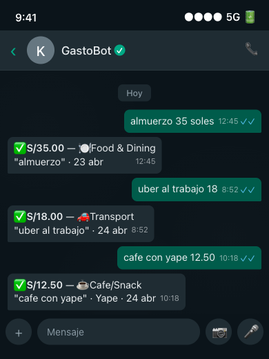
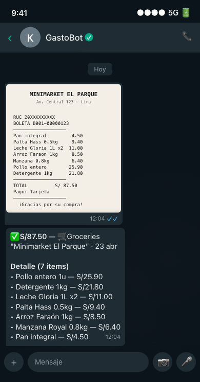
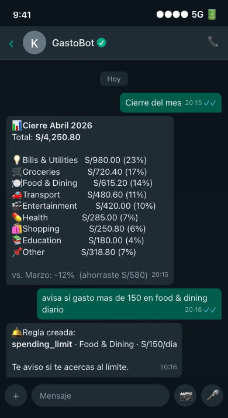

# GastoBot

**A WhatsApp-first expense tracker for Peru.** Send a free-text message like
`almuerzo 35 soles` and the bot parses, categorizes, and stores the expense.
Send a photo of a receipt and it extracts the line items. Ask `cierre del mes`
and get a category breakdown vs. the previous month.

No app to open. No form to fill. No friction.

<p align="center">
  
</p>

---

## Why

Every expense tracker I tried turned into a five-minute ritual: open app, tap
"add", pick a category, type an amount, save. I'd skip a day, then a week,
then give up.

WhatsApp is already a habit. The best tracker is the one you'd send a message
to anyway.

GastoBot is a personal finance tool I use daily. It ships to production on
Railway, and every architectural decision optimizes for **"what keeps me
logging?"** over "what is the most flexible design?"

The product is Spanish (LATAM) and PEN-first because Peru is where I live —
adding currencies and locales is straightforward but has not been prioritized.

---

## What it does

- **Log from text.** `uber 18` → parsed, categorized, stored.
  `cena con Maria 140 con TC Visa` captures merchant, amount, and payment
  method in a single Claude call.
- **Log from receipt photos.** Send a boleta/invoice photo. Claude Vision
  extracts merchant, total, and line items.
- **Dynamic categories.** The AI suggests a new category when an expense
  does not fit an existing one; you confirm to create.
- **Monthly closing.** `cierre del mes` returns a category breakdown, total,
  and delta vs. the previous month.
- **Financial rules.** `avisa si gasto mas de 150 en food & dining diario`
  creates a spending-limit rule; the bot alerts when you approach it.
- **Corrections and deletions.** `no, era 45 no 40` corrects the last entry.
  `borra el último` soft-deletes it.

<table>
<tr>
<td align="center"><b>Receipt photo → itemized breakdown</b></td>
<td align="center"><b>Monthly closing + spending rule</b></td>
</tr>
<tr>
<td></td>
<td></td>
</tr>
</table>

_Screenshots are synthetic mockups with made-up numbers. Source HTML lives in
`docs/screenshots/source/`._

---

## Stack

- **Runtime** — Node.js 22+, ESM, TypeScript strict mode
- **Server** — Fastify
- **Data** — Supabase (Postgres + Storage) via the JS client, no REST layer
- **AI** — Claude Sonnet 4.5 for intent + extraction + categorization in a
  single call; Claude Vision for receipt parsing
- **WhatsApp** — Kapso Cloud API
- **Hosting** — Railway (persistent process)
- **Testing** — Vitest, 454 unit tests plus three accuracy gates against the
  real Claude API

---

## Architectural choices worth flagging

These are deliberate and constrain the codebase:

- **Single flat project.** No monorepo, no packages, no shared-types folder.
  All source under `src/`, all tests under `tests/`.
- **One LLM call per message.** Intent, extraction, and categorization happen
  in a single Claude call, not a chain. Cheaper, faster, and less surface area
  for cascading failures.
- **In-memory conversation state** with TTL expiry. No state table. If the
  process restarts, pending confirmations are lost — acceptable for a
  30-second confirmation loop.
- **Categories emerge from use.** Users do not configure categories upfront.
  The AI suggests one when an expense does not fit; the user confirms to
  create.
- **Accuracy gates, not just unit tests.** Integration tests call the real
  Claude API against fixtures and fail if parse accuracy drops below a
  threshold. They are excluded from `npm test` because each run costs about
  $0.50.

---

## Running it locally

Prerequisites: Node 22+, a Supabase project, an Anthropic API key, and a Kapso
account.

```bash
npm install
cp .env.example .env          # fill in your values
# Run migrations via the Supabase SQL editor (see migrations/*.sql)
# Then seed your first user:
npm run add-user -- --phone +51999888777 --name "Your Name"
npm run dev
```

Point Kapso's webhook at your exposed `/webhook` endpoint (ngrok in dev, the
Railway URL in production).

---

## Testing

```bash
npm test                      # unit tests — 454 tests, ~350ms
npx tsc --noEmit              # type check
npm run test:integration      # real Claude + Supabase calls, ~80s, ~$0.50
```

The integration suite runs three accuracy gates:

| Gate | Threshold | Current |
|------|-----------|---------|
| Text parse | ≥ 85% | 100% |
| Receipt parse | ≥ 70% | run with your own fixtures — see `tests/fixtures/receipts/README.md` |
| Integration parse (payment / category / rule intents) | ≥ 85% | 97.9% |

Gates block downstream tasks — if accuracy drops, the feature does not ship.

---

## Status

MVP feature-complete and in daily personal use. Single-tenant by design — one
user per deployment. Things deliberately out of scope:

- Multi-user auth / onboarding flows
- Proactive scheduled alerts (would require cron/scheduler architecture)
- Bank statement PDF parsing (better suited for a separate web companion)
- Shared expenses / splitting

These live in `docs/TASKS.md` under "Future Ideas (Not Scoped)".

---

## License

ISC
